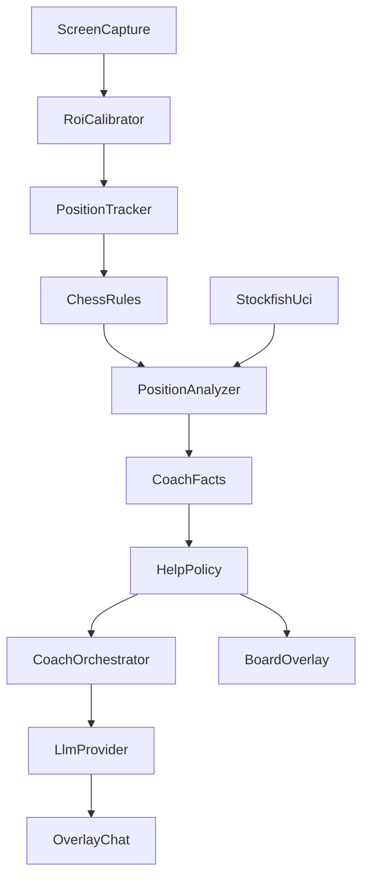

# Arquitetura

A v1 é um app desktop em Python 3.12 e PySide6. Cada caixa abaixo é um módulo com contrato. A implementação de um módulo não importa a implementação de outro; importa o contrato.



A visão não gera texto. O Gemini não escolhe o lance. `CoachFacts` é o objeto entre o analisador e a política, não um processo.

## Layout do código

```
src/chesscoach/
  capture/screen.py          ScreenCapture
  vision/roi.py              RoiCalibrator
  vision/squares.py          assinatura das 64 casas
  vision/classifier.py       PieceClassifier
  vision/tracker.py          PositionTracker e o agendador
  chess/game.py              partida python-chess
  engine/uci.py              ChessEngine
  analysis/facts.py          CoachFacts
  analysis/analyzer.py       PositionAnalyzer
  coach/policy.py            HelpPolicy
  coach/orchestrator.py      CoachOrchestrator
  llm/provider.py            LlmProvider
  llm/gemini.py              GeminiProvider
  ui/coach_window.py
  ui/training_dialog.py
  ui/moves_popup.py
  ui/board_overlay.py
  config.py
tests/
```

Dependências de runtime: PySide6, OpenCV, `python-chess`, cliente HTTP do SDK oficial `google-genai`, e um binário Stockfish apontado por configuração. O executável do Stockfish não é empacotado (a licença é GPL). Captura de tela no Windows via `dxcam` ou equivalente já embrulhado por `ScreenCapture`. O restante do código não cita DXGI.

## Contratos

### ScreenCapture

```python
class ScreenCapture(Protocol):
    def grab(self, monitor: int, region: Rect) -> Frame: ...
```

`Rect` é `x`, `y`, `width`, `height` em pixels do monitor. `Frame` carrega os pixels e o instante. Não existe método de "tela inteira em loop" no contrato usado pelo tracker.

### PieceClassifier

```python
class PieceClassifier(Protocol):
    def read_board(self, frame: Frame, orientation: Orientation, theme: Theme) -> BoardRead: ...
```

`BoardRead` traz, por casa, a peça ou vazio, e uma confiança de 0 a 1. A v1 implementa comparação com templates dos temas `lichess_2d` e `chesscom_2d`. Casa vazia é decidida pela cor esperada da casa (clara ou escura), amostrada fora do miolo ocupado pela peça. Um modelo futuro substitui esta classe sem mudar o tracker.

Se qualquer casa ficar abaixo da confiança mínima, `BoardRead.ok` é falso. O chamador descarta a leitura inteira.

### PositionTracker

Dono do agendador e da tradução de pixels em lance.

Estados:

- `idle`: captura a cada 250 ms.
- `moving`: captura a cada 100 ms. Entra aqui quando a assinatura das 64 casas se afasta do último quadro estável além do limiar.
- Volta a `idle` quando dois quadros seguidos ficam parecidos. Esse quadro estável é o único que pode virar lance.
- Se `moving` durar mais de 1 s sem dois quadros parecidos, volta a `idle`, não altera a partida, e publica `BoardUnstable`.

O limiar é uma constante nomeada, ajustada com imagens de teste. Ele usa o miolo de cada casa. Mudança fora das 64 casas não conta.

O tracker emite um destes resultados: `NoChange`, `MoveConfirmed` (lance SAN legal), `Ambiguous`, `PromotionNeeded`, `BoardUnstable`, `ReadRejected`.

### ChessEngine

```python
class ChessEngine(Protocol):
    def analyze(self, fen: str) -> EngineResult | None: ...
```

`EngineResult` tem `evaluation_cp` (ponto de vista das Brancas, como o UCI), até três lances em UCI na ordem do motor, e o melhor lance. A implementação sobe um processo Stockfish e fala UCI. Tempo padrão: 300 ms (`movetime`), configurável. Se o processo não existir ou não responder, o retorno é `None`.

### PositionAnalyzer

Não escreve frase para a pessoa. Junta a posição do `python-chess` com o `EngineResult` e devolve `CoachFacts`. Se o motor voltar `None`, os campos de motor ficam `None` ou lista vazia, e os campos estáticos continuam preenchidos.

Definições:

- `hanging_squares`: casas das peças de quem vai jogar que estão atacadas e sem defesa.
- `threatened_squares`: casas das peças de quem vai jogar que estão atacadas. Inclui as soltas.
- `development.white` e `development.black`: quantidade de cavalos e bispos fora da casa inicial, de 0 a 4. Peça capturada não conta. Dama, torre e peão não entram.
- Rei, para cada lado: `on_start_square`, `kingside_rights`, `queenside_rights`. `castled` é verdadeiro se o histórico gravado contém o roque daquele lado; `None` se a partida foi assumida no meio, sem histórico.
- `moved_piece`: tipo e cor da peça do último lance, ou `None`.
- `moved_piece_rule`: frase fixa em português de como aquela peça anda, vinda de um mapa estático. O Gemini pode elaborar; a regra base não é inventada pelo modelo.

Avaliações em centipawns são sempre do ponto de vista das Brancas. `previous_evaluation_cp` é a avaliação da posição anterior, para o nível Master medir o lance que acabou de acontecer.

### CoachFacts

```python
@dataclass
class KingFacts:
    on_start_square: bool
    kingside_rights: bool
    queenside_rights: bool
    castled: bool | None

@dataclass
class CoachFacts:
    fen: str
    side_to_move: Literal["white", "black"]
    last_move_san: str | None
    in_check: bool
    moved_piece: str | None
    moved_piece_rule: str | None
    evaluation_cp: int | None
    previous_evaluation_cp: int | None
    best_move_san: str | None
    candidate_moves_san: list[str]
    hanging_squares: list[str]
    threatened_squares: list[str]
    development_white: int
    development_black: int
    own_king: KingFacts
    opponent_king: KingFacts
```

Lances no objeto estão em SAN. A frase "rei inseguro" não é campo. A política deriva o texto de `on_start_square`, direitos de roque e `castled`.

### HelpPolicy

```python
class HelpPolicy(Protocol):
    def apply(self, facts: CoachFacts, level: Level, reason: Reason) -> PolicyDecision: ...
```

`Reason` é `move_confirmed`, `hint_requested` ou `chat_message`.

`PolicyDecision` contém:

- `speak`: se o coach fala sozinho desta vez.
- `facts_for_model`: um `CoachFacts` com chaves apagadas (campos proibidos em `None` ou lista vazia).
- `eval_band`: `None` ou um destes textos: `vantagem grande`, `vantagem`, `equilíbrio`, `desvantagem`, `desvantagem grande`. A política calcula a faixa a partir de `evaluation_cp` (limites em constantes: 150 e 400 centipawns). O número cru não vai para o modelo nos níveis 2, 3 e Master.
- `arrow`: `None` ou um lance SAN. A janela de setas só desenha se este campo estiver preenchido e o botão Setas estiver ligado.
- `threat_squares`: casas que podem ser marcadas como atenção. Vazio quando o nível não mostra ameaça no tabuleiro.

Regras de recorte para fala espontânea (`move_confirmed`):

| Nível | Fala | No pacote do modelo | Seta |
| --- | --- | --- | --- |
| Iniciante total | sim | regra da peça, último lance, `best_move_san`; candidatas vazias | só se a pessoa já pediu casas legais nesta posição |
| Nível 1 | sim | `best_move_san` e candidatas | o melhor lance, se Setas estiver ligado |
| Nível 2 | sim, se houver xeque, peça solta, ameaça ou rei no centro | sem `best_move_san`, sem candidatas, sem centipawns; com `eval_band`, ameaças e rei | nenhuma |
| Nível 3 | sim | sem lance, sem centipawns; com `eval_band`, desenvolvimento, rei e ameaças | nenhuma |
| Master | sim, só porque um lance acabou de ser confirmado | último lance, `eval_band` da variação (`previous_evaluation_cp` contra `evaluation_cp`); sem próximo lance | nenhuma |

`hint_requested` (botão Dica, ou pedido explícito no chat) preenche `best_move_san` em todos os níveis e pode preencher `arrow` com esse lance. Candidatas continuam de fora no Iniciante total e no Master; nos outros níveis podem ir junto.

Pedido explícito no chat é correspondência com uma lista fixa de intenções, sem segunda chamada ao modelo: "qual lance", "o que jogar", "melhor jogada", "sugere", "sugira", "me dá uma dica", "dica". Na dúvida, o motivo permanece `chat_message` e o lance não é liberado. A resposta pode dizer para usar o botão Dica.

`chat_message` que não pede lance usa o mesmo recorte da fala espontânea daquele nível. No Master, uma pergunta no chat pode ser respondida sobre o lance já feito e sobre a posição, ainda sem o próximo lance, salvo pedido explícito.

O prompt do orquestrador diz ao modelo: use somente os fatos recebidos; se `best_move_san` estiver ausente, não nomeie lance nem casa de destino de uma jogada sugerida.

### LlmProvider

```python
class LlmProvider(Protocol):
    def complete(self, messages: list[Message], model: str) -> str: ...
```

`GeminiProvider` implementa isso com o SDK `google-genai`. Outro provedor é outra classe. O id do modelo vem de `config.gemini_model`, um único constante. A chave é a variável de ambiente `GEMINI_API_KEY`, lida só dentro do provedor.

## Fluxo de um lance

1. O tracker está em `idle` e a partida já tem um tabuleiro lógico no `python-chess`.
2. A assinatura das casas muda. Estado `moving`. Motor e Gemini continuam parados.
3. Dois quadros a 100 ms ficam parecidos. Estado `idle`.
4. O tracker lista os lances legais e, para cada um, as casas de peça que mudariam (origem, destino, torre no roque, peão capturado no en passant).
5. Um lance legal serve se essas casas estão entre as casas cuja assinatura mudou. Sumiço do destaque do lance anterior pode mudar casas a mais; isso não cria um segundo lance.
6. Zero lances compatíveis: `NoChange` (brilho, destaque, ruído).
7. Um lance: aplica no `python-chess`, incluindo roque, captura e en passant.
8. Peão na última fila: `PromotionNeeded` até o template da casa de destino cravar a peça com confiança, ou até a pessoa escolher dama, torre, bispo ou cavalo. Sem isso o lance não entra.
9. Dois lances compatíveis: `Ambiguous`. A partida não muda. O chat pede para repetir o lance devagar ou informar o lance.
10. Posição nova e estável: o analisador monta `CoachFacts`, a política recorta, o orquestrador chama o Gemini uma vez.
11. A seta, se houver, usa o `arrow` da política.

O Gemini também é chamado quando a pessoa envia uma mensagem ou aperta Dica. Não é chamado por quadro.

Modo "acompanhar do início": o tabuleiro lógico começa na posição inicial padrão. Não há classificação de peça a cada lance.

Modo "ler posição agora": o `PieceClassifier` lê as 64 casas uma vez. `BoardRead.ok` falso rejeita a leitura. Se for verdadeiro, essa FEN vira a partida, com histórico vazio (`castled` fica `None`), e o acompanhamento segue como no modo anterior.

Orientação (`white_at_bottom` ou `black_at_bottom`) é escolhida na calibração e define qual canto do retângulo é a8.

## Configuração

Arquivo do usuário, fora do repositório, em `%APPDATA%/ChessCoach/config.json`. Campos:

- `training_accepted`: bool. Falso impede análise, dica, seta e chat.
- `level`: um dos cinco níveis.
- `monitor`, `roi`, `orientation`, `theme`.
- `stockfish_path`.
- `gemini_model`.
- `engine_movetime_ms`: padrão 300.
- `arrows_enabled`: padrão falso.

A chave da API não entra nesse JSON. Só `GEMINI_API_KEY`. Log nenhum registra a chave.

## Erros visíveis

- Tabuleiro ilegível: a leitura agora falhou a confiança. Mensagem: "Não consegui ler o tabuleiro. Confira o tema e o retângulo das 64 casas."
- Tabuleiro instável: a animação passou de 1 s. Mensagem: "O tabuleiro não estabilizou. Pause animações ou marque só as 64 casas."
- Lance ambíguo: "Vi mais de um lance possível. Jogue de novo ou escreva o lance."
- Promoção sem peça: a janela pergunta a peça.
- Stockfish ausente: campos de motor vazios. Iniciante total ainda explica a regra da peça. Os outros níveis dizem: "O motor não está configurado. Indique o caminho do Stockfish."
- Sem `GEMINI_API_KEY`: "Falta a chave GEMINI_API_KEY. O coach não consegue escrever." Os fatos e a seta permitida pela política ainda podem aparecer, porque não dependem do modelo.

## Testes

Sem tela, sem Stockfish e sem rede:

- Assinaturas de casas em imagens fixas: par estável, par em animação, par só com destaque de último lance. O terceiro não pode virar lance.
- Dois quadros parecidos terminam `moving`. Estourar 1 s publica `BoardUnstable`.
- Diferença de casas mais regras: lance simples, captura, roque, en passant, promoção. Lance ilegal não é aplicado.
- Classificador com um tabuleiro fixture de cada tema. Uma casa estragada de propósito torna `ok` falso.
- Analisador numa posição conhecida do `python-chess`: peça solta, xeque, desenvolvimento e rei batem com o esperado. Com `EngineResult` nulo, os campos estáticos continuam.
- Política, para cada nível e cada `Reason`: no nível 2 com `move_confirmed`, `best_move_san` vai vazio para o modelo. Com `hint_requested`, vai preenchido. Master com `move_confirmed` não recebe o próximo lance. Estes testes não chamam o Gemini.
